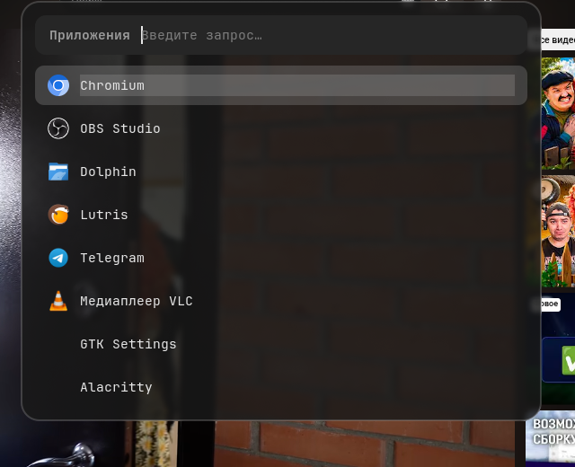

<p align="center">
    <br/>
    
</p>

# hyprland-dotfiles · Hyprland + Rofi + Waybar

Лёгкая графитовая конфигурация рабочего стола на **CachyOS** для ноутбука 1366×768.
Палитра: тёмный фон `#181818`, текст `#e6e6e6`, акцент `#9a9a9a` — те же оттенки используются в **Hyprland** (рамки окон), **Rofi**, **Waybar** и в меню на базе Rofi.

## Состав

| Компонент           | Файл                        | Что внутри |
|----------------------|-----------------------------|------------|
| Hyprland 0.56+       | `hypr/hyprland.lua`         | конфиг **на Lua** (не hyprlang): мониторы, окна, воркспейсы, бинды, blur |
| Rofi                 | `rofi/config.rasi`<br>`rofi/themes/graphite.rasi` | лаунчер приложений, меню обоев, эмодзи, питание в одной теме |
| Waybar               | `waybar/config.jsonc`<br>`waybar/style.css` | воркспейсы, раскладка, часы, звук, сеть, питание, яркость, батарея |
| Установка            | `install.sh`                | симлинки `~/.config/{hypr,rofi,waybar}` → этот репозиторий |

## Горячие клавиши

- `Super + D` ↦ приложения (rofi drun)
- `Super + Shift + W` ↦ сменить обои
- `Super + .` ↦ эмодзи (копирование в буфер)
- `Super + Shift + P` ↦ меню питания: выключить / перезагрузить / спящий режим / выйти

## Установка

```bash
git clone https://github.com/rom446107-design/hyprland-dotfiles.git
cd hyprland-dotfiles
./install.sh
```

`install.sh` привязывает каталоги репозитория к `~/.config` симлинками и сохраняет
существующие конфиги как `~/.config/<name>.bak.<время>`.
После этого достаточно перезапустить Hyprland.

## Программы

| Пакет                   | Зачем |
|--------------------------|-------|
| `hyprland`              | композитор (Wayland) |
| `waybar`, `rofi`        | бар и лаунчер |
| `swaybg`                | обои |
| `foot`                  | терминал (используется в Waybar для сети) |
| `power-profiles-daemon` | управление профилями питания |
| `brightnessctl`         | регулировка яркости |
| `pavucontrol`           | GUI для Pipewire-звука |
| `nmcli`, `nmtui`        | управление сетью |
| `wl-copy`               | буфер обмена (для эмодзи) |
| `notify-send`           | уведомления при смене обоев |

## Настройка

- Палитра задаётся в трёх местах, чтобы всё менялось синхронно:
  `rofi/themes/graphite.rasi`, `waybar/style.css` и `hypr/hyprland.lua` (цвета рамок окон).
- Скрипты меню (`rofi/scripts/*.sh`) — самостоятельные, других зависимостей в репозитории нет.
- При добавлении нового модуля в `waybar/config.jsonc` добавь его стиль в `waybar/style.css` (id вида `#language`).
- Обои меняются через `Super + Shift + W`; последний выбор сохраняется в `~/.local/state/rofi-wallpaper` и восстанавливается при следующем входе.

## Лицензия

MIT — см. файл [LICENSE](./LICENSE).
